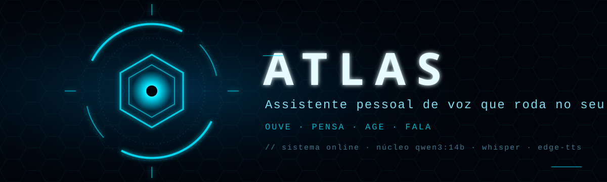
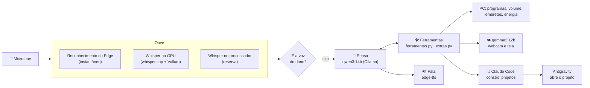

<p align="center">
  
</p>

<p align="center">
  
  
  
  
  
</p>

**Atlas** é um assistente pessoal de voz no estilo "mordomo digital", que roda no próprio computador. Você fala com ele pelo microfone e ele responde com voz, abre programas, cuida de lembretes, controla o PC, enxerga a tela e a webcam e, quando o pedido é grande, chama o **Claude Code** para construir programas de verdade, que abrem no editor **Antigravity**.

O cérebro do dia a dia é um modelo local (`qwen3:14b` no Ollama), então conversa, comandos e memória ficam no seu PC.

---

## Sumário

- [O que ele faz](#o-que-ele-faz)
- [Como funciona](#como-funciona)
- [O que o Atlas já construiu](#o-que-o-atlas-já-construiu)
- [Segurança](#segurança)
- [Instalação](#instalação)
- [Uso](#uso)
- [Estrutura do projeto](#estrutura-do-projeto)
- [Privacidade](#privacidade)

---

## O que ele faz

| Área | Exemplos do que dá para falar |
|---|---|
| 🗣️ **Conversa** | "Atlas, qual a diferença entre RAM e memória de vídeo?" · depois de chamar pelo nome, a conversa segue sem precisar repetir "Atlas" |
| 🖥️ **Programas e web** | "Abre o Chrome" · "Pesquisa preço de SSD de 2 TB" · "Toca lo-fi no YouTube" · "Quais as notícias de tecnologia?" |
| ⏰ **Lembretes e alarmes** | "Me lembra às 15h de ligar pro fornecedor" · "Daqui a 20 minutos me avisa do forno" · "Cancela os lembretes" |
| 🎛️ **Controle do PC** | Volume, mudo, play/pausa, próxima música · fechar programas · bloquear a tela · suspender, hibernar, desligar ou reiniciar (com 60 s para cancelar) |
| 📊 **Saúde do PC** | "Como está o PC?" (CPU, RAM, GPU, discos, processos mais pesados) · "Faz um teste de estabilidade" |
| 👁️ **Visão** | "O que você vê?" (webcam, com `gemma3:12b`) · "Que erro é esse na minha tela?" (print da tela analisado) |
| 📝 **Textos e arquivos** | "Escreve uma legenda de Instagram sobre…" salva o texto completo num arquivo e fala só o resumo |
| 🧠 **Memória** | "Lembra que eu prefiro respostas curtas" fica guardado e entra em todas as conversas |
| 🛠️ **Engenheiro (Claude Code)** | "Cria um app para monitorar meu PC" · "Melhora o monitor e adiciona undervolt" · "Pesquisa a fundo e me faz um relatório sobre…" |
| 🎙️ **Voz** | Voz neural `pt-BR-AntonioNeural`, com efeito robótico ajustável ("deixa a voz mais robótica") |
| 🔐 **Voz do dono** | Cadastre sua voz e ele só obedece a você (impressão de voz com `sherpa-onnx`) |

## Como funciona



- **Interface** (`interface.html`): HUD futurista com o "olho" do Atlas, que muda de cor conforme o estado (escutando, ouvindo, pensando, falando), registro da conversa, escolha do microfone e botões de escuta, voz e visão. Abre como app no Edge.
- **Servidor** (`servidor.py`): FastAPI em `http://127.0.0.1:7777`. Recebe o áudio, transcreve, conversa com o modelo, executa ferramentas e gera a voz.
- **Escuta em três níveis:** primeiro o reconhecimento do próprio Edge, depois o Whisper na placa de vídeo AMD (whisper.cpp com Vulkan, porta 7778) e, se nada disso estiver disponível, o Whisper no processador.
- **Anti "fingir que fez":** se o modelo responde "pronto, abri" sem chamar ferramenta nenhuma, o servidor cobra a ação antes de responder.
- **Hora sempre certa:** a data e a hora atuais entram em cada mensagem, então ele cumprimenta certo (bom dia, boa tarde, boa noite).
- **Tarefas em segundo plano:** pedidos ao Claude rodam por trás. A interface acompanha e o Atlas avisa por voz quando terminam.

## O que o Atlas já construiu

Tudo isto foi pedido **por voz** ao Atlas, que delegou ao Claude Code. O Claude criou, testou e entregou os resultados.

### 📈 Monitor do Computador (app de desktop)

App com janela própria (pywebview, sem navegador), atalho na Área de Trabalho e opção de abrir com o Windows.

- **Ao vivo, com gráficos dos últimos 2 minutos:** CPU (uso total, por núcleo, frequência), GPU (uso, VRAM, **temperatura**, ventoinha), RAM, rede por adaptador e discos (espaço, leitura/escrita, SSD/HDD, saúde).
- **Modo jogo em um clique:** liga o Modo de Jogo do Windows, desliga a gravação em segundo plano do Xbox Game Bar, ativa o plano Alto desempenho com turbo agressivo e desliga o core parking. Guarda como estava antes e **Desativar** volta tudo ao original. Durante o jogo, o próprio monitor fica leve (coleta a cada 3 s, prioridade baixa).
- **Overclock da CPU:** perfis Economia / Padrão / Desempenho / Máximo, plano de energia e estados do processador, sem precisar de administrador. Para CPUs sem multiplicador livre, explica o que dá para fazer na BIOS.
- **Undervolt da GPU AMD:** tensão, frequência máxima, limite de potência e VRAM pelo driver da AMD (ADLX). Se você não clicar em **Manter** em 20 s, tudo volta sozinho. Também tem **Restaurar padrão de fábrica**.
- **RAM:** mostra cada módulo (velocidade atual, XMP, JEDEC) e tem o botão **Reiniciar na BIOS** com o passo a passo.

### ✅ Testes automáticos

- **Bateria de testes do Monitor:** confere se cada ajuste recomendado está realmente ativo (Modo de Jogo, Game Bar, plano de energia, turbo, core parking, HAGS, perfil do MSI Afterburner, XMP) e se a plataforma está lendo dados reais (CPU no turbo, temperatura da GPU, driver AMD respondendo). Os testes só leem dados e não alteram nada. **Resultado: 28 OK, 2 avisos, 0 falhas**, com relatório em Markdown e JSON.
- **Teste de estabilidade do PC** (ferramenta do Atlas): erros críticos desde o boot, desligamentos inesperados (Kernel-Power 41 / 6008), erros de hardware WHEA, programas que travaram, CPU e RAM sob amostragem, saúde dos SSDs e se Ollama e Whisper estão no ar. Gera um relatório em texto.
- **Reinício com teste automático:** "Atlas, reinicia o PC" agenda o reinício e, quando o Windows volta, o Atlas espera o sistema assentar, roda o teste de estabilidade e fala o resultado.

### 📚 Guias e relatórios

- Guia de overclock da CPU, undervolt da GPU e overclock da RAM, com foco em estabilidade.
- O que são os ajustes de CPU, GPU e BIOS e como afetam os jogos.
- Undervolt na GPU: como afeta o limite de potência, os tipos de undervolt e qual escolher para jogar.
- Perfil otimizado do MSI Afterburner para jogos.
- Pesquisa de mercado: produtos mais vendidos no Natal no Brasil, com resumo.
- Posts e legendas para redes sociais.

## Segurança

- **Ações drásticas só com pedido explícito.** Desligar, reiniciar, suspender, bloquear a tela ou fechar programas só acontecem se as palavras do pedido realmente disserem isso. O modelo local às vezes "adivinha", e o servidor barra.
- **Desligar e reiniciar têm 60 s de espera.** Diga "Atlas, cancela" para desistir.
- **Programas protegidos:** o Atlas não fecha o Windows, o Ollama, o Whisper nem a si mesmo.
- **O Claude trabalha com limites:** pode ler, escrever, pesquisar e rodar comandos para testar o que cria, mas não pode apagar arquivos, formatar discos, desligar o PC nem fazer `git push`.
- **Voz do dono:** com a impressão de voz cadastrada, falas de outras pessoas (ou da TV) são ignoradas.

## Instalação

**Requisitos:** Windows 11, Python 3.12, [Ollama](https://ollama.com) e o Edge (já vem no Windows). Testado com i7-11700F, Radeon RX 9070 XT (16 GB) e 64 GB de RAM. Uma placa com 12 GB ou mais roda o `qwen3:14b` inteiro na GPU.

1. Baixe os modelos:
   ```
   ollama pull qwen3:14b
   ollama pull gemma3:12b
   ```
2. Crie o ambiente e instale as dependências:
   ```
   python -m venv .venv
   .venv\Scripts\pip install -r requirements.txt
   ```
3. Copie `config.exemplo.json` para `config.json` e ajuste seu nome, as pastas e os atalhos de programas. Opcional: `dica_voz`, uma frase com nomes próprios que você costuma falar, ajuda o Whisper a acertá-los.
4. **Opcional:**
   - **Engenheiro:** instale o [Claude Code](https://claude.com/claude-code), faça login uma vez (`claude` e depois `/login`) e tenha o Antigravity instalado.
   - **Whisper na GPU AMD:** compile o [whisper.cpp](https://github.com/ggml-org/whisper.cpp) com Vulkan em `..\motores\whisper.cpp` e coloque `ggml-large-v3-turbo-q8_0.bin` e `ggml-silero-v5.1.2.bin` em `modelos-voz/`. O `iniciar-atlas.vbs` liga o `whisper-server` sozinho.
   - **Voz do dono:** coloque o modelo `speaker.onnx` em `modelos-voz/` e cadastre sua voz pela interface.

## Uso

| Arquivo | O que faz |
|---|---|
| `iniciar-atlas.vbs` | Liga o Ollama, o Whisper na GPU e o servidor, e abre a interface (sem janela preta) |
| `desligar-atlas.vbs` | Desliga tudo: servidor, Whisper e a janela do Atlas |
| `reiniciar-tudo.ps1` | Reinicia todos os componentes |
| `instalar-inicializacao.ps1` | Faz o Atlas iniciar com o Windows e cria os atalhos |

Depois é só falar **"Atlas, …"**. Fechar a janela no X só esconde a interface: para liberar a memória da placa de vídeo, use o `desligar-atlas.vbs`.

## Estrutura do projeto

```
atlas/
├── servidor.py           # API: ouvir, conversar, falar, câmera, projetos, voz do dono
├── ferramentas.py        # programas, web, arquivos, memória, notícias, status do PC, Claude Code
├── extras.py             # lembretes, controle do PC, ver a tela, teste de estabilidade
├── voz_dono.py           # impressão de voz (sherpa-onnx)
├── interface.html        # HUD do Atlas
├── config.exemplo.json   # modelo de configuração
├── iniciar-atlas.vbs / desligar-atlas.vbs / reiniciar-tudo.ps1 / instalar-inicializacao.ps1
└── docs/banner.svg
```

## Privacidade

O repositório tem só o código. Ficam apenas no seu PC (e estão no `.gitignore`): `config.json`, memória, histórico de conversas, lembretes, tarefas, impressão de voz, perfil do navegador do Atlas, logs e os modelos baixados.

A conversa e a memória são processadas localmente pelo Ollama. Usam a internet: o reconhecimento de voz do Edge e a voz do `edge-tts` (serviços da Microsoft), a busca de notícias e, quando você pede, o Claude Code.
